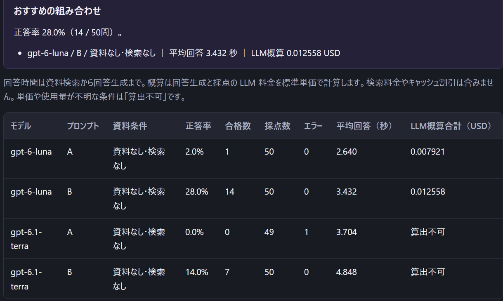

# AI回答の比較・評価ツール

同じ質問で AI モデル、プロンプト、資料の参照方法を比較し、業務に合う組み合わせを見つけます。HTML ファイルをブラウザーで開くだけで使えます。

## はじめる

**[オンラインで AI設定発見ツールを開く](https://ahirose.github.io/llm-qa-eval/)** と、インストールやファイルのダウンロードなしで実行できます。「5. 比較」で「サンプルで試す」を選ぶと、API キーを用意する前に操作を確認できます。

オフラインでサンプルを試す場合は、次の手順で HTML ファイルを保存してください。

1. GitHub の [index.html](https://github.com/ahirose/llm-qa-eval/blob/main/index.html) を開き、元ファイルをダウンロードします。
2. 保存した `index.html` をダブルクリックし、普段使っているブラウザーで開きます。
3. 「次へ」で比較画面まで進み、「サンプルで試す」を選んで「比較を実行」を押します。既定でサンプル10問を比較します。1問で試す場合は「最初の1問だけで試す」を選びます。

使うのはブラウザーと HTML ファイル1枚です。Python、ライブラリ、インストール作業は不要です。サンプル比較はオフラインで実行できます。

## 自分の業務で試す

1. **AI モデル**で「モデルを追加」を押し、OpenAI・Claude・Gemini・Grok から選びます。選択すると接続先が入るので、表示名、モデル ID、API キーを入力します。1モデルでもプロンプトや資料条件を比較でき、2モデル以上を登録するとモデル間の比較もできます。「先頭モデルの接続を確認」で一覧の先頭を試せます。採点モデルも一覧から選びます。
2. **回答時に参照する資料**では、必要に応じて UTF-8 の TXT・Markdown を選びます。検索（RAG）を使う場合は、Pinecone の Index Host、API キー、本文フィールド名を入力します。
3. **システムプロンプト**で回答モデルへの指示を入力します。A と B を入力すると、両方が比較対象になります。
4. **質問と模範回答**で「CSVテンプレートを取得」を押します。Excel や Google スプレッドシートで `id`（質問の識別子）、`question`（質問）、`reference`（模範回答）を入力し、UTF-8 の CSV として保存します。「質問・模範解答ファイルを選択」で読み込めます。質問・模範回答を用意する前は、同梱の日本語サンプル10問を使えます。
5. **比較して調整**で「登録した実サービスを使う」を選びます。「比較を実行」を押すと、登録済みの全モデルについて、資料の有無と検索の有無を組み合わせて全質問を比較します。資料と Pinecone の両方を設定すると、両方なし、資料のみ、検索のみ、両方ありの4条件になります。未設定の機能は「なし」の条件で扱います。

比較では、複数の質問を同時に処理できます。既定は2件で、1〜8件から選べます。各質問の資料検索、回答生成、採点は順番に行います。HTTP 429 が出る場合は、まず同時処理数を1に下げてください。

結果画面では、おすすめの組み合わせと、その平均回答時間・LLM 概算費用を最初に表示します。条件別の集計に続く「不合格だった質問」で、質問・模範回答・生成回答・採点理由を確認できます。「比較結果 CSV を保存」には質問別の回答時間と概算費用も含まれます。サンプルは固定応答なので、プロンプトの変更による回答品質の差は実モデルで評価します。

おすすめは全問の採点が完了した条件から、正答率が高い順、1問あたりの回答生成費用が安い順、平均回答時間が短い順に選びます。同じ正答率では、費用を算出できた条件を優先します。

実サービスで比較すると、おすすめ欄に人が回答した場合との **100問あたりの費用差・時間差・正答率差** も表示されます。初期値は正答率95%、人件費25 USD／時間、1問3分の仮定です。比較画面で変更してから実行してください。AI 側の費用は回答生成分を使用し、採点・Pinecone・人による確認や手直しは含みません。時間は各回答時間の合計です。

回答時間はブラウザーで測定し、資料検索から回答生成までを含みます。LLM 費用は、回答生成と採点の API が返した使用量と、登録モデルの100万トークンあたりの入力・出力単価（USD）から計算します。公式 OpenAI 接続先の GPT-6 Luna と GPT-6.2 Sol には標準単価の初期値があります。「1. AI モデル」で単価を上書きしたり、他のモデルの単価を指定したりできます。Pinecone の検索料金やキャッシュ割引は含めず、単価や使用量が不明な条件は「算出不可」と表示します。 [OpenAI API 料金](https://developers.openai.com/api/docs/pricing)

6. **設定の保存**で「設定 JSON を保存」を押すと、モデル ID・接続先・プロンプトなどを PC に保存できます。次回は手順1「AI モデル」で設定 JSON ファイルを選び、「設定を読み込む」を押します。質問 CSV と直接入力の資料は、使うときに再度選択します。

   API キーと検索トークンは、既定では設定ファイルに含めません。保存する場合は「秘密情報も暗号化して保存」を選び、12文字以上のパスフレーズを指定します。暗号化済みの設定を復元する場合は、ファイルを選んでからパスフレーズを入力し、「設定を読み込む」を押します。

## 出力結果の例

10問で比較した際の画面です。この実行では、資料あり・検索なしの GPT-6 Luna が、プロンプト A・B ともに10問正解しました。各候補の下に、人が回答する場合との費用差・時間差・正答率差を100問あたりの試算として表示しています。

## 実サービスへの接続

設定はブラウザー内で扱い、保存を選ぶと利用者の PC に JSON ファイルとして書き出します。GitHub Pages に設定が保存されることはありません。API キーと検索トークンは既定で保存されず、保存を選んだ場合はパスフレーズで暗号化します。

実行時には、質問・資料・認証情報が必要に応じて指定先へ送信されます。回答生成と採点には API 利用料が発生します。接続先がブラウザーからのアクセス（CORS）を許可している必要があり、サービスやアカウントの設定によって接続できない場合は、組織で用意しているブラウザー対応の接続先を確認してください。

## Pinecone の設定

1. Pinecone コンソールで、資料を登録済みのテキスト埋め込み機能付きインデックスを開きます。Index Host をコピーし、画面の「2. 回答時に参照する資料」に貼り付けます。
2. そのインデックスを検索できる API キーを入力します。資料が名前付き Namespace にある場合はその名前を入れ、既定の Namespace なら空欄にします。
3. 抜粋が保存されているフィールド名を入力します。画面の初期値は `chunk_text` です。
4. 「Pinecone の接続を確認」を押します。読み込んでいる質問の先頭1件を検索します。0件の場合は、質問、Namespace、登録した資料を確認してください。
5. 比較画面で「登録した実サービスを使う」を選び、「比較を実行」を押します。Pinecone 検索のあり・なしが自動で比較されます。

ブラウザーから Pinecone の Search Records API を直接呼び出します。ベクトルだけを登録したインデックスを使う場合は、現在のテキスト検索方式に対応するインデックスと本文フィールドを用意してください。以前の汎用検索設定から移行する場合は、Pinecone の接続情報を入力し直してください。 [Pinecone Search Records API](https://docs.pinecone.io/reference/api/2025-10/data-plane/search_records)

ブラウザーが接続を拒否する場合は、ネットワークと接続先の CORS 設定を確認してください。Pinecone への実接続は利用する環境で「Pinecone の接続を確認」から試せます。
