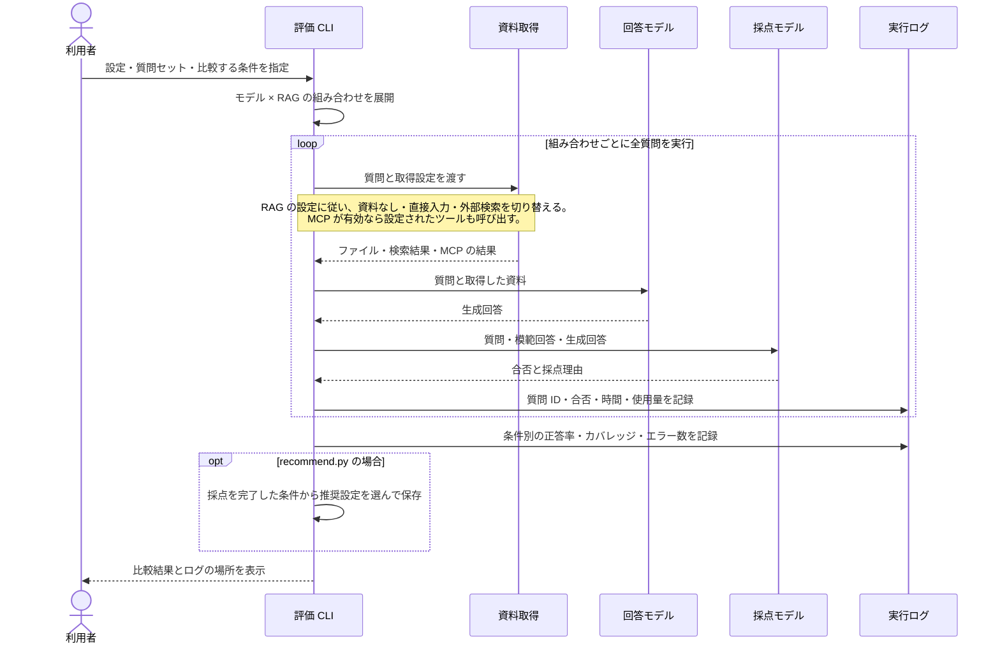

# Q&A Harness

固定の質問・模範回答セットで、根拠の取得方式、MCP ツール、回答モデルの変更が正答率・応答時間・トークン使用量にどう影響するかを比較する Python CLI です。設定は TOML、データセットとログは JSONL、モックは Python 標準ライブラリで動作します。Python 3.11 以上が必要です。

## ディレクトリ構成

```text
common/                 共通のモデル呼び出し・資料取得・回答生成
  data/                 共通の参照資料と模擬検索データ
comparison/             比較実行・採点・推奨設定・統計分析
  data/cases.jsonl      比較・採点用の質問と模範回答
  runs/                 比較ログと推奨設定の履歴（実行時に生成）
answering/
  batch.py              推奨設定を使った一括回答
  data/questions.jsonl  回答生成用の質問
  configs/              日時付き推奨設定（実行時に生成）
  outputs/              回答リスト（実行時に生成）
configs/                共通の TOML 設定
tests/                  自動テスト
```

コマンドはリポジトリ直下から実行します。TOML 内の資料パスは TOML ファイルの場所を基準に解決します。

## すぐに試す

ZIP を展開し、README があるフォルダで実行します。

```powershell
python -m unittest discover -s tests -v
python -m comparison.runner ask --profile direct "セキュリティインシデントの疑いがある場合、どこに報告しますか？"
python -m comparison.runner eval --dataset comparison/data/cases.jsonl --profiles baseline direct search tool
```

架空の社内セキュリティを題材にした日本語の質問が10件あります。`cases.jsonl` は評価用の模範回答付き、`questions.jsonl` は一括回答用です。モックでは baseline が 0/10、ほかの3方式が 10/10 になるよう設計しています。この結果は動作確認用です。

## モデル × RAG を一括比較する

### 試験から回答リストを作る

`recommend.py` は全組み合わせを採点し、比較結果と推奨設定を出力します。全件を採点できた組み合わせのうち、正答率が最も高いものを選びます。同率なら RAG なし、平均回答時間が短いもの、設定名順で決めます。全件を採点できた組み合わせがなければ、推奨設定は空になります。

`answer_batch.py` は推奨設定と試験時と同じ TOML を読み込み、採点なしで質問に回答します。入力は `id` と `question` を持つ JSONL で、出力には質問と回答が入力順に並びます。失敗した質問にはエラー種別を記録します。既存の回答ファイルとの上書きを避けるため、再実行時は新しい出力ファイル名を指定します。

```powershell
python -m comparison.recommend --dataset comparison/data/cases.jsonl --models mock_a mock_b --rag none external
python -m answering.batch --recommendation answering/configs/recommended-YYYYMMDD-HHMMSS-mmmZ-ID.json --questions answering/data/questions.jsonl --output answering/outputs/answers.jsonl
```

実 API で使う場合は両方のコマンドに `--config configs/live.local.toml` を追加します。試験側のモデル名は `--models openai claude` に変更します。

推奨設定は既定で `answering/configs/recommended-YYYYMMDD-HHMMSS-mmmZ-ID.json` に生成します。日時は UTC（末尾の Z）、ミリ秒とランダム ID で同時刻の出力を区別します。同じ内容を比較ログのフォルダにも保存します。ファイル内にはタイムゾーン付き生成日時、元の比較ログ、設定ファイルの参照・ハッシュ、採用したモデル・RAG・MCP 設定を記録します。秘密値は環境変数名で参照してください。

回答コマンドの `--recommendation` には、比較終了時に表示された実際のファイル名を指定します。実行時は比較に使用した同じ TOML を指定してください。既定の TOML は `configs/mock.toml` です。推奨設定は履歴として保存され、既存ファイルへの上書きはエラーになります。

### 比較結果だけを出す

`compare` は、モデルと RAG 条件の全組み合わせを同じ質問セット・採点モデルで実行します。次のコマンドは2モデル × 2条件の4組を試します。

```powershell
python -m comparison.runner compare --dataset comparison/data/cases.jsonl --models mock_a mock_b --rag none external
```

実サービスでは、`live.local.toml` の `[matrix.models]` に比較するモデルの別名と ID、`[matrix.retrievals]` に検索や直接入力の設定を記入します。必要な環境変数と `[judge]` を設定して実行します。

```powershell
python -m comparison.runner --config configs/live.local.toml compare --dataset comparison/data/cases.jsonl --models openai claude --rag none external
```

`--rag` の既定値は `none external` です。直接ファイル入力も並べるには `--rag none external direct` を指定します。MCP は既定で無効です。`[matrix.mcp]` を設定すると全組み合わせで同じツールを使います。

端末には組み合わせごとの合格数、正答率、採点済み件数、エラー件数、平均回答時間が表示されます。平均回答時間には検索と MCP の時間を含み、回答を取得できたケースで集計します。ケース別の合否・使用量は同じ実行の JSONL で確認できます。

## 実サービスを接続する

1. 仮想環境で `python -m pip install -r requirements.txt` を実行します。
2. `configs/live.example.toml` を同じフォルダの `live.local.toml` にコピーします。利用可能なモデル ID と、使用する場合は MCP のツール名・引数名を入力します。
3. 利用するサービスの認証情報と接続先 URL を、OS またはシークレットマネージャー経由で実行プロセスの環境変数に設定します。モデルは `OPENAI_API_KEY` / `ANTHROPIC_API_KEY`、検索・MCP はサンプル設定にある環境変数を参照します。Bearer 認証が不要なら、そのプロファイルから `token_env` を外します。
4. 同じ質問セット、同じ採点モデルで比較します。まず `baseline direct`、検索の準備ができたら `direct search`、MCP は `baseline tool`、モデル変更は `direct claude_direct` を比較します。

```powershell
python -m comparison.runner --config configs/live.local.toml eval --dataset comparison/data/cases.jsonl --profiles baseline direct
```

### 切り替え

- `model` は `provider`、`id`、任意の `max_tokens`。OpenAI Responses API と Anthropic Messages API を使用します。利用モデルはアカウントと入力形式に合わせて指定します。
- `retrieval.mode` は `none` / `direct-file` / `external-search`。直接入力は設定ファイルを基準とした `files` で UTF-8 の TXT・Markdown または PDF を指定します。OpenAI は `input_file`、Anthropic は PDF を `document`、テキストファイルをメッセージ内のテキストブロックで送ります。合計5 MiB が上限です。
- 外部検索は HTTPS の JSON API に `POST {"query":"...","top_k":3}` を送り、`{"results":[{"id":"doc-1","text":"passage"}]}` を受け取ります。既存の Pinecone 検索を使う場合は、質問の埋め込みとインデックス照会を担当する検索サービスから、この形式で結果を返します。
- `mcp.mode` は `none` / `remote`。MCP Python SDK v1 の Streamable HTTP で、設定された信頼済みサーバー上の参照系ツールを各質問で一度呼びます。`arguments` の固定引数に、`question_arg`（既定値 `query`）で質問を追加します。比較条件を固定するため、モデルにはツールの戻り値を渡します。ツールはテキストの content ブロックを返す必要があります。

質問は設定に応じて外部検索・MCP・モデルに送信されます。回答モデルには取得結果またはファイルが、採点モデルには質問・模範回答・候補回答が送信されます。接続前にデータの取り扱いを確認し、デモには同梱の架空データを使ってください。秘密値を設定・データセット・ツール引数に記入しないでください。

## 評価とログ

### 評価の処理シーケンス

`comparison.recommend` と `comparison.runner compare` は同じ評価処理を使います。



回答生成や採点でエラーが起きた質問は、失敗した段階をログに記録して次の質問に進みます。採点理由と生成回答をログに含めるには `--log-content` を指定します。

各データ行は `id`、`question`、`reference` の文字列を持ちます。`judge` は全プロファイル共通です。実モデルの採点では JSON の合否と理由を検証し、採点形式の異常は実行エラーとしてカウントします。正答率は合格数÷採点済み件数、カバレッジは採点済み件数÷全件です。カバレッジとエラー件数も併せて確認してください。

`comparison/runs/` の JSONL は設定・データセットの SHA-256、ケース ID、方式、モデル ID、使用量、回答生成（取得・MCP を含む）と採点の所要時間、合否、エラー段階を記録します。質問・模範回答・原文の検索結果は保存しません。`--log-content` を付けると生成回答と採点理由もローカルに保存します。保存内容に元の資料が引用される可能性があります。

応募デモでは、同じ資料を検索側とファイル側に用意し、モデルと採点条件を固定して、検索なし・外部検索・直接入力を比較できます。過去の Security Q&A Assistant の 70%→90% は当時の結果として扱い、このサンプルの結果とは区別します。実験を報告する際は、データセット、モデル ID、検索インデックスの版と、正答率・件数・カバレッジを添えられます。

## 正答率の差を確認する

`compare_stats.py` は、同じ評価ランに含まれる2条件を質問 ID で対応させます。模範回答付きの質問セットを両条件に使い、採点モデル、回答指示、元資料を揃えてください。外部検索の効果だけを見たいときは、回答モデルも揃えます。

```powershell
python -m comparison.runner --config configs/live.local.toml compare --dataset comparison/data/holdout.jsonl --models openai --rag external direct --logs comparison/runs/holdout
python -m comparison.statistics --log "comparison/runs/holdout/<実行ログ名>.jsonl" --baseline openai/external --candidate openai/direct
```

2行目の `--log` には、1行目の末尾に表示された JSONL のパスを指定します。標準出力は JSON です。`difference_pp` は候補の正答率から基準の正答率を引いた差（パーセントポイント）で、`pair_counts` には両方合格・改善・悪化・両方不合格の件数が出ます。100問中25問が改善し5問が悪化した場合は +20 ポイントです。

- **不確実性**は、対応ありブートストラップの95%信頼区間（`bootstrap.ci95_pp`）で確認できます。再標本化は既定で10,000回、乱数シードは42です。質問が互いに独立とみなせる場合は、両側の正確 McNemar 検定の p 値も出します。
- **同じ規程やシナリオに由来する質問**には、データセットに共通の `"group":"incident-policy"` を付けてから評価します。ブートストラップはグループをまとめて再標本化し、グループ指定のない質問は各1単位として扱います。グループ付きのランでは、質問の独立性を仮定する McNemar 検定は省略します。独立した質問やグループが少ない場合や、改善・悪化がまれな場合は区間の精度が落ちます。再標本化で差が変動しない場合、区間は `null` になります。
- **回答生成・採点エラー**は条件ごとに数えます。未採点があれば、正答率差は両方が採点済みの質問に限った参考値になり、区間・検定は出しません。実運用では回答エラー件数も全質問数を分母に確認します。
- **許容できる品質低下**を事前に3ポイントと決めた場合は、集計コマンドに `--margin-pp 3` を加えます。95%信頼区間の下限が −3 ポイントを上回れば `met`、上回らなければ `not_demonstrated`、区間が得られなければ `inconclusive` です。

### 推奨条件を最終確認する

1. 規程やシナリオ単位で、組み合わせ選択用と最終確認用の質問を分けます。予備試験で合否が食い違う割合を測り、確認したい最小差や許容差に応じて、確認用の質問数を決めます。
2. 選択用のセットで `recommend.py` を実行します。最終確認では、選んだ候補と現行条件の主比較を、結果を見る前に決めます。多数の条件を比較する段階は探索として扱います。
3. 未使用の質問セットで両条件を評価し、上のコマンドで差と区間を報告します。一部の回答はモデル・方式を伏せて人手でも採点し、Judge との一致と重大な誤答を確認します。

既存の JSONL にも対応しています。過去の 70%→90% を検証するには、当時の同一質問ごとの合否が必要です。

- [対応ありブートストラップの適用例](https://aclanthology.org/www.mt-archive.info/EMNLP-2004-Koehn.pdf)
- [対応あり二値データに対する McNemar 検定](https://pubmed.ncbi.nlm.nih.gov/23848987/)
- [LLM-as-a-Judge の人手評価との比較](https://proceedings.neurips.cc/paper_files/paper/2023/file/91f18a1287b398d378ef22505bf41832-Paper-Datasets_and_Benchmarks.pdf)

## 検証範囲

同梱テストはモックでの CLI 比較、取得エラー時の集計、外部検索のリクエスト形式、採点 JSON の型、重複 ID を確認します。実アカウントでの OpenAI / Anthropic 呼び出し、PDF 入力、外部検索、MCP 接続、Pinecone のインデックス照会は未検証です。API の仕様は以下を参照しました。

- [OpenAI Responses API のファイル入力](https://developers.openai.com/api/docs/guides/file-inputs)
- [Anthropic Messages API](https://platform.claude.com/docs/en/api/messages/create) · [PDF 入力](https://platform.claude.com/docs/en/build-with-claude/pdf-support)
- [MCP Python SDK v1](https://github.com/modelcontextprotocol/python-sdk/tree/v1.x)
